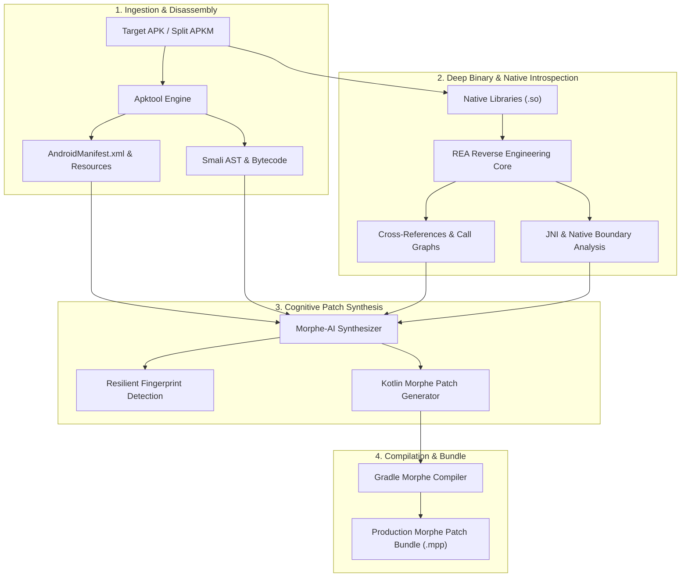

<div align="center">


# 🛠️ Morphy Patches Creator

[](LICENSE)
[](https://github.com/SatanMerde/Morphy-Patches-Creator/actions/workflows/ci.yml)
[]()
[](https://github.com/MorpheApp)
[]()

**The Ultimate Reverse Engineering Workbench & Automated Patch Synthesis Pipeline for Android**

*Unifying the decompilation power of **Apktool**, the deep binary & native introspection of **REA**, and the automated bytecode synthesis of **Morphe-AI**.*

---

[AI Clients & MCP](#-supported-ai-clients--mcp-protocol) •
[The Pillars & Credits](#-the-pillars--upstream-attribution) •
[Architecture](#-architecture--workflow) •
[Quick Start & Setup](#-quick-start) •
[Capabilities & Limitations](#-capabilities-vs-%EF%B8%8F-technical-limitations) •
[Legal & Ethics](#%EF%B8%8F-legal--ethical-disclaimer)

---

</div>

## 🌟 Overview

**Morphy Patches Creator** is an end-to-end patch development workbench built for the **Morphe** ecosystem. Developing resilient patches for modern Android apps requires mastering three distinct disciplines:
1. **Resource & Smali Unpacking**: Parsing binary XML, resolving `resources.arsc`, and extracting Dalvik bytecode.
2. **Deep Binary & Native Introspection**: Analyzing native libraries (`.so`), mapping cross-references, tracing control flow graphs, and unmasking obfuscated routines.
3. **Patch Synthesis**: Translating analyzed hooks into resilient, upgrade-tolerant Kotlin code that complies with Morphe's AST and bytecode manipulation API.

**Morphy Patches Creator bridges these disciplines by seamlessly integrating three industry-leading open-source engineering pillars into one unified, cohesive workflow.**

---

## 🤖 Supported AI Clients & MCP Protocol

Morphy Patches Creator acts as a native reverse-engineering and patch synthesis extension for AI assistants. Simply open this repository in your preferred AI environment—your agent automatically connects to Morphy's Model Context Protocol (MCP) server and toolchain to analyze applications, trace opcodes, and write resilient Morphe patches.

### 🌐 Client Compatibility Matrix

| AI Environment | Integration Type | Configuration File | Auto-Setup Command |
| :--- | :--- | :--- | :--- |
| **Antigravity IDE** | Native Skill | `.agents/skills/morphe-patch-creator/SKILL.md` | `morphy-creator setup --client antigravity` |
| **Claude Code & Desktop** | MCP & Agent Rules | `CLAUDE.md` | `morphy-creator setup --client claude` |
| **Cursor** | Rules & MDC | `.cursorrules` / `.cursor/rules/` | `morphy-creator setup --client cursor` |
| **GitHub Copilot & Codex** | Agent Instructions | `.github/copilot-instructions.md` | `morphy-creator setup --client codex` |
| **Windsurf** | Cascade Rules | `.windsurfrules` | `morphy-creator setup --client windsurf` |
| **Any MCP Host** | Stdio Protocol | `morphy-creator mcp` | Automatic JSON-RPC |

### 🩺 Environment & Client Diagnostics

Run diagnostics to verify that your decompilers and client rules are ready:
```bash
morphy-creator doctor
```

Configure all AI client integrations in a single command:
```bash
morphy-creator setup --client all
```

---

## 🏛️ The Pillars & Upstream Attribution

Morphy Patches Creator stands on the shoulders of giants. We give full credit, homage, and our highest gratitude to the authors and maintainers of the three foundational projects powering our engine:

### 1. 📦 [Apktool](https://github.com/iBotPeaches/Apktool) by Connor Tumbleson & Ryszard Wiśniewski
* **Creator / Lead Maintainer**: Connor Tumbleson ([@iBotPeaches](https://github.com/iBotPeaches)) and Ryszard Wiśniewski ([@brutall](https://github.com/brutall))
* **Repository**: [https://github.com/iBotPeaches/Apktool](https://github.com/iBotPeaches/Apktool)
* **License**: Apache 2.0
* **Our Integration**: Apktool serves as the primary ingestion and disassembly foundation. It unpacks APKs and split APK bundles (APKM/APKS), decodes binary Android XML (`AndroidManifest.xml`), decodes `resources.arsc` IDs, and disassembles Dalvik bytecode into Smali ASTs for structural analysis.

### 2. 🔬 [REA (Reverse Engineer Anything)](https://github.com/morluto/rea) by @morluto
* **Creator / Lead Maintainer**: [@morluto](https://github.com/morluto)
* **Repository**: [https://github.com/morluto/rea](https://github.com/morluto/rea)
* **License**: Open Source
* **Our Integration**: REA powers Morphy's deep inspection phase. Whenever an app relies on native C/C++ libraries (`.so`), JNI boundaries, Il2Cpp metadata, or intricate cross-reference chains, REA's multi-target reverse engineering engine analyzes instruction flows, detects security triggers, maps callers/callees, and correlates static symbols with runtime behavior.

### 3. 🧠 [Morphe-AI](https://github.com/Paresh-Maheshwari/morphe-ai) by Paresh Maheshwari
* **Creator / Lead Maintainer**: Paresh Maheshwari ([@Paresh-Maheshwari](https://github.com/Paresh-Maheshwari))
* **Repository**: [https://github.com/Paresh-Maheshwari/morphe-ai](https://github.com/Paresh-Maheshwari/morphe-ai)
* **License**: Open Source
* **Our Integration**: Morphe-AI provides the cognitive patch generation core. It evaluates the disassembly and native findings to synthesize production-ready Kotlin patch definitions compliant with Morphe Patcher (e.g., generating resilient `Fingerprint` matchers, `replaceInstructions`, `replaceMethod`, and parameter overrides that survive target app updates).

---

### 4. 📄 [JADX](https://github.com/skylot/jadx) by @skylot
* **Repository**: [https://github.com/skylot/jadx](https://github.com/skylot/jadx)
* **Our Integration**: Provides high-level Java source code decompilation synchronized with Smali, allowing LLMs and AI agents to understand application logic and semantics effortlessly.

### 5. 🔍 [Androguard](https://github.com/androguard/androguard) by Anthony Desnos
* **Repository**: [https://github.com/androguard/androguard](https://github.com/androguard/androguard)
* **Our Integration**: Fast pure-Python static analysis, control flow graphing (CFG), and string/method cross-referencing.

---

## ⚡ Key Features

- **⚡ Unified CLI & Agentic Pipeline**: From raw APK to compiled Morphe `.mpp` patch bundle in a single command.
- **🎯 Resilient Fingerprinting**: Generates opcode-sequence and string-based fingerprints that withstand ProGuard, R8, and DexGuard obfuscation.
- **🧩 Split APK & Dynamic Features**: Full support for base + split APKs, merging, and localized resources.
- **🛡️ Native Boundary Mapping**: Traces Java-to-Native (JNI) calls to identify bypass targets in native libraries.
- **📝 Idiomatic Kotlin Generation**: Produces clean, readable Morphe patch classes adhering to official patch architecture.
- **🧪 Dry-Run Patch Verification**: Simulates patch execution against the decompiled target before building to catch AST discrepancies early.

---

## 🏗️ Architecture & Workflow



---

## 🚀 Quick Start

### Prerequisites
- **Python**: 3.10 or later
- **Java JRE/JDK**: 17 or later (for Apktool & Morphe Gradle builds)
- **Git**

### Installation

```bash
# Clone the repository
git clone https://github.com/SatanMerde/Morphy-Patches-Creator.git
cd Morphy-Patches-Creator

# Install dependencies and CLI
pip install -e .
```

### 🤖 Zero-Code AI Mode (Create Patches Without Coding)

> **No programming experience required!** Simply describe your objective in natural language, and Morphy's AI agent analyzes the target APK, pinpoints hook targets, generates resilient Kotlin code, and compiles the ready-to-use `.mpp` bundle for **Morphe Manager**:

```bash
# 1. Instant one-line automated patch creation:
morphy-creator auto app.apk --prompt "Remove all ads and banners" -o ./my_patches

# 2. Or launch the step-by-step interactive wizard:
morphy-creator wizard
```

---

### 🛠️ Advanced Developer Pipeline (Manual CLI)


```bash
# 1. Inspect an APK and extract its components (via Apktool)
morphy-creator unpack /path/to/target.apk -o ./workspace

# 2. Deep-scan native libraries and logic triggers (via REA)
morphy-creator inspect ./workspace --symbols --native

# 3. Synthesize a Morphe Kotlin patch (via Morphe-AI)
morphy-creator synthesize ./workspace \
    --type unlock \
    --target-feature "subscription_verification" \
    --output ./generated_patches

# 4. Build into a distribution-ready .mpp bundle
morphy-creator build ./generated_patches
```


### 📦 Split APK / Bundle Merger (.apkm, .xapk, .apks)

Automatically extract and resolve split packages into a unified base APK for analysis:
```bash
morphy-creator merge /path/to/bundle.apkm -o ./merged_apk
```

---

### 🩺 Patch Verifier & Linter

Lint synthesized Morphe Kotlin patches to ensure register safety, annotation validity, and fingerprint health:
```bash
morphy-creator verify ./generated_patches/MyPatch.kt
```

---

### 📖 Built-in Battle-Tested Recipes Catalog

Explore pre-configured recipes for common patch objectives:
```bash
morphy-creator recipes
```


---

## 🎯 Capabilities vs. ⚠️ Technical Limitations

For an exhaustive breakdown and edge-case mitigations, refer to [**`docs/LIMITATIONS.md`**](docs/LIMITATIONS.md).

### ✅ What Morphy Patches Creator Can Do
- **Multi-DEX & Split APK Ingestion**: Decompiles monolithic APKs, split APK sets (`APKM`, `APKS`, base + config splits), and extracts Dalvik bytecode via **Apktool**.
- **Binary XML & Resource Resolution**: Fully decodes `AndroidManifest.xml` and maps `resources.arsc` table IDs to human-readable UI attributes.
- **Deep Native Introspection**: Dissects `.so` C/C++ libraries (ARM64/x86), identifies JNI export functions, maps cross-references, and detects anti-tamper logic via **REA**.
- **Resilient Opcode Fingerprinting**: Generates update-tolerant AST fingerprints that survive ProGuard, R8, and DexGuard renaming.
- **Idiomatic Kotlin Patch Synthesis**: Translates analyzed targets into production-grade Morphe patch classes (`replaceMethod`, `replaceInstructions`, `Fingerprint`) via **Morphe-AI**.
- **One-Click Patch Bundling**: Simulates patches with dry-run verification and compiles distribution `.mpp` archives.

### ⚠️ What Morphy Patches Creator Cannot Do (Technical Boundaries)
1. **Server-Side Authorization**: Patches operate exclusively on the local client. Features enforced by remote backend servers (e.g., server-verified subscriptions, remote database entitlements, cloud-side DRM token generation) cannot be granted via client bytecode modification.
2. **Commercial Native Kernel Packers**: Targets armored with heavy commercial packers (*SecNeo, Tencent Legu, Bangcle, DexGuard O-LLVM*) that encrypt DEX files on disk require a memory dump (via dynamic dumping or Frida runtime) before Morphy can decompile them.
3. **Hardware TEE / StrongBox Play Integrity**: Cryptographic hardware attestation executed inside the secure enclave (TEE/Keymint) cannot be bypassed with Dalvik bytecode patches; it requires system/kernel-level solutions (such as Zygisk modules).
4. **Dynamically Loaded Cloud Payloads**: Bytecode fetched from the cloud at runtime cannot be analyzed purely statically and requires dynamic REA tracing during an active runtime session.

---

## 📂 Project Structure

```
Morphy-Patches-Creator/
├── .agents/skills/                 # Antigravity IDE native skill
├── .cursor/rules/                  # Cursor IDE patch creation rules
├── .github/                        # Copilot/Codex instructions & issue templates
├── CLAUDE.md                       # Claude Code & Claude Desktop agent instructions
├── .cursorrules                    # Cursor root workspace rules
├── .windsurfrules                  # Windsurf Cascade agent rules
├── morphy_creator/
│   ├── mcp_server.py               # Standard Model Context Protocol (MCP) server
│   ├── doctor.py                   # Multi-client environment doctor (REA-style)
│   ├── adapters/
│   │   ├── apktool_adapter.py      # Bridge to Apktool decompilation & resource decoding
│   │   ├── rea_adapter.py          # Bridge to REA multi-target native & binary analysis
│   │   └── morphe_ai_adapter.py    # Bridge to Morphe-AI patch logic synthesis
│   ├── core/
│   │   ├── pipeline.py             # Orchestrates the 4-phase patching workflow
│   │   └── config.py               # Tool paths, options, and model configurations
│   ├── synthesizer/
│   │   ├── fingerprint_generator.py # Generates resilient Morphe AST fingerprints
│   │   └── patch_template_engine.py# Emits clean Morphe Kotlin source code
│   ├── templates/                  # Jinja2 templates for Kotlin Morphe patches
│   └── cli.py                      # Interactive & headless CLI interface
├── docs/
│   ├── ARCHITECTURE.md             # Detailed engineering and component blueprint
│   ├── CREDITS.md                  # Comprehensive attribution & upstream profiles
│   ├── LEGAL.md                    # Legal framework, compliance & ethical boundaries
│   ├── LIMITATIONS.md              # Deep breakdown of capabilities vs boundaries
│   └── GETTING_STARTED.md          # Step-by-step developer tutorial
├── tests/                          # Automated unit and integration tests
├── pyproject.toml
├── LICENSE
└── README.md
```

---

## ⚖️ Legal & Ethical Disclaimer

> [!IMPORTANT]
> **PLEASE READ CAREFULLY BEFORE USING THIS TOOLKIT**

1. **Educational & Research Purpose**: Morphy Patches Creator is developed solely for educational, academic security research, software interoperability, and personal customization purposes.
2. **Reverse Engineering for Interoperability**: Reverse engineering for interoperability is recognized and protected under applicable laws, including **17 U.S.C. § 1201 (DMCA Section 1201 Exemptions)** and the **EU Software Directive (2009/24/EC, Article 6)**.
3. **No Circumvention of Access Controls**: This tool is not intended to bypass paid paywalls, conduct software piracy, defeat DRM, or infringe upon proprietary intellectual property. Users are solely responsible for ensuring their usage complies with all local, national, and international laws.
4. **Third-Party Trademarks**: All app names, trademarks, logos, and brands referenced in examples or test cases belong to their respective owners. Their mention implies neither endorsement nor affiliation.
5. **Upstream Intellectual Property**: Apktool, REA, and Morphe-AI are the intellectual property of their respective creators. Morphy Patches Creator acts as an integration and orchestration layer and does not claim ownership over any upstream technology.

---

## 🤝 Contributing

Contributions, issues, and feature requests are welcome!  
Feel free to check out the [issues page](https://github.com/SatanMerde/Morphy-Patches-Creator/issues).

---

## 📜 License

This project is licensed under the **Apache License 2.0** - see the [LICENSE](LICENSE) file for details.  
Please also review the respective licenses of [Apktool](https://github.com/iBotPeaches/Apktool/blob/master/LICENSE.md), [REA](https://github.com/morluto/rea), and [Morphe-AI](https://github.com/Paresh-Maheshwari/morphe-ai).
