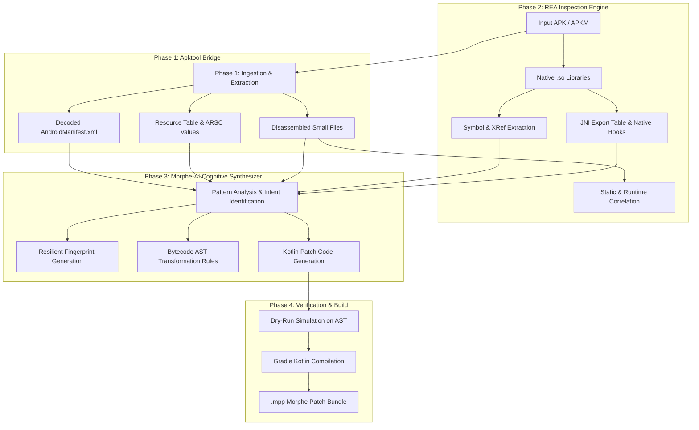

# 🏗️ Morphy Patches Creator Architecture

This document describes the engineering design and inter-process data flow of Morphy Patches Creator.

## Component Breakdown

### 1. Ingestion Bridge (`morphy_creator/adapters/apktool_adapter.py`)
- Wraps the Apktool execution environment.
- Handles split APK reconstitution (APKM/APKS to unified structure).
- Decodes resources while preserving XML namespaces and original resource IDs.

### 2. Binary Introspection Core (`morphy_creator/adapters/rea_adapter.py`)
- Communicates with REA tools via JSON-RPC / MCP protocols.
- Extracts symbol tables from native shared objects (`lib*.so`).
- Maps JNI function signatures to Java/Kotlin native method declarations.
- Identifies cryptographic routines, integrity checks, and billing verification flows.

### 3. Cognitive Synthesizer (`morphy_creator/synthesizer/`)
- Inspired by Morphe-AI.
- Computes opcode fingerprints that ignore variable register allocations and obfuscated class/method names.
- Renders typed Kotlin Morphe patches inheriting from `BytecodePatch`, `ResourcePatch`, or `SettingsPatch`.

### 4. Pipeline Engine (`morphy_creator/core/pipeline.py`)
- Orchestrates caching, intermediate artifact management, dry-run testing, and invocation of the Gradle compiler to generate `.mpp` archives.
